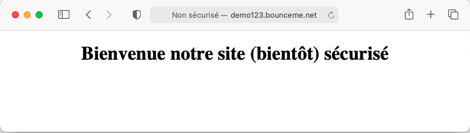
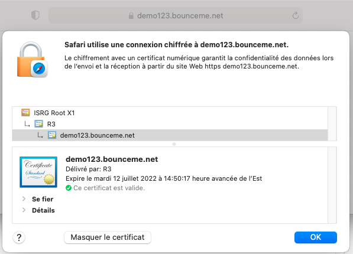

# Installation d’un certificat signé sur un hôte virtuel apache2

*Document converti depuis ve2cuy.com/420-21e — 12 février 2022*

---

## Résumé

Dans ce laboratoire, nous allons apprendre à mettre en place un certificat signé ([TSL/SSL](https://fr.wikipedia.org/wiki/Transport_Layer_Security)) sur un hôte virtuel Apache2.

Ce qui permettra la publication du site web en mode sécurisé ‘HTTPS’.

Il existe plusieurs solutions payantes pour ce type de certificat. Par exemple, les hébergeurs (comme [godaddy](https://www.godaddy.com/en-ca/web-security/ssl-certificate)) proposent cette solution dans leur offre de services.

Il est possible de générer un certificat gratuitement en utilisant un projet comme [Certbot](https://certbot.eff.org). C’est ce que nous ferons ici.

---

Pré-requis

* Une adresse IP exposée sur le réseau Internet.
* Un nom de domaine public associé à l’adresse IP
* Un serveur apache2 installé et fonctionnel
* Un hôte virtuel Apache2

---

## 1 – Mise en place des pré-requis

1.1 – Création d’une VM sur cloud.google.com

1.2 – [Installation d’apache2](Ajout-d-une-pile-AMP.md)

sudo apt install apache2

1.3 – [Mise en place d’un hôte virtuel Apache2](Apache2-Hotes-virtuels-et-htaccess.md)

```
# Création d'un dossier pour le site virtuel
sudo mkdir -p /var/www/demo123.bounceme.net/

# Ajout d'une page d'accueil pour notre site top Sécuritaire:
$ sudo nano /var/www/demo123.bounceme.net/index.html
<!DOCTYPE html>
<html>
  <head>
    <meta charset="utf-8">
    <title>Bienvenue notre site sécurisé</title>
  </head>
  <body>
    <h1><center>Bienvenue notre site (bientôt) sécurisé</center></h1>
  </body>
</html>

# Ajuster les accès au nouveau site:
$ sudo chown -R www-data:www-data /var/www/demo123.bounceme.net/
```

#### 1.3.2 – Renseigner le fichier de configuration du site virtuel

```
# sudo nano /etc/apache2/sites-available/demo123.bounceme.net.conf
# Listen 80
# Listen 8080
# <VirtualHost *>

<VirtualHost *:80>
    ServerName demo123.bounceme.net
    ServerAlias www.demo123.bounceme.net
    ServerAdmin webmaster@demo123.bounceme.net
    DocumentRoot /var/www/demo123.bounceme.net/

    <Directory /var/www/demo123.bounceme.net/>
        Options -Indexes +FollowSymLinks
        AllowOverride All
    </Directory>

    ErrorLog ${APACHE_LOG_DIR}/demo123.bounceme.net-error.log
    CustomLog ${APACHE_LOG_DIR}/demo123.bounceme.net-access.log combined
</VirtualHost>
```

```
$ sudo a2ensite demo123.bounceme.net
$ sudo systemctl restart apache2
```

1.4 – Associer l’adresse IP externe de la VM à un nom de domaine – [noip](https://www.noip.com).

1.5 – Tester le site virtuel :



---

## 2 – Installer certbot

```
sudo snap install core; sudo snap refresh core
sudo snap install --classic certbot
sudo ln -s /snap/bin/certbot /usr/bin/certbot
```

## 3 – Créer et installer un certificat SSL

[Étapes à partir du site Certbot](https://certbot.eff.org/instructions?ws=apache&os=ubuntufocal)

```
$ sudo certbot --apache

Saving debug log to /var/log/letsencrypt/letsencrypt.log
Enter email address (used for urgent renewal and security notices)
 (Enter 'c' to cancel): alain.boudreault@me.com

- - - - - - - - - - - - - - - - - - - - - - - - - - - - - - - - - - - - - - - -
Please read the Terms of Service at
https://letsencrypt.org/documents/LE-SA-v1.2-November-15-2017.pdf. You must
agree in order to register with the ACME server. Do you agree?
- - - - - - - - - - - - - - - - - - - - - - - - - - - - - - - - - - - - - - - -
(Y)es/(N)o: Y

- - - - - - - - - - - - - - - - - - - - - - - - - - - - - - - - - - - - - - - -
Would you be willing, once your first certificate is successfully issued, to
share your email address with the Electronic Frontier Foundation, a founding
partner of the Let's Encrypt project and the non-profit organization that
develops Certbot? We'd like to send you email about our work encrypting the web,
EFF news, campaigns, and ways to support digital freedom.
- - - - - - - - - - - - - - - - - - - - - - - - - - - - - - - - - - - - - - - -
(Y)es/(N)o: N
Account registered.

Which names would you like to activate HTTPS for?
- - - - - - - - - - - - - - - - - - - - - - - - - - - - - - - - - - - - - - - -
1: demo123.bounceme.net
2: www.demo123.bounceme.net
- - - - - - - - - - - - - - - - - - - - - - - - - - - - - - - - - - - - - - - -
Select the appropriate numbers separated by commas and/or spaces, or leave input
blank to select all options shown (Enter 'c' to cancel): 1
Requesting a certificate for demo123.bounceme.net

Successfully received certificate.
Certificate is saved at: /etc/letsencrypt/live/demo123.bounceme.net/fullchain.pem
Key is saved at:         /etc/letsencrypt/live/demo123.bounceme.net/privkey.pem
This certificate expires on 2022-07-12.
These files will be updated when the certificate renews.
Certbot has set up a scheduled task to automatically renew this certificate in the background.

Deploying certificate
Successfully deployed certificate for demo123.bounceme.net to /etc/apache2/sites-available/demo123.bounceme.net-le-ssl.conf
Congratulations! You have successfully enabled HTTPS on https://demo123.bounceme.net

- - - - - - - - - - - - - - - - - - - - - - - - - - - - - - - - - - - - - - - -
If you like Certbot, please consider supporting our work by:
 * Donating to ISRG / Let's Encrypt:   https://letsencrypt.org/donate
 * Donating to EFF:                    https://eff.org/donate-le
- - - - - - - - - - - - - - - - - - - - - - - - - - - - - - - - - - - - - - - -
```

---

## Voilà, notre site web est maintenant sécurisé!



**Note**: Assurez-vous que le port 443 (HTTPS) est ouvert sur votre VM!

---

## Étapes facultatives

4 – Au besoin, s’assurer que les règles du pare feu laissent passer les requêtes vers le service http

```
$ sudo ufw status

---

Status: active

To                         Action      From
--                         ------      ----
OpenSSH                    ALLOW       Anywhere
Apache                     ALLOW       Anywhere    # --> Ceci ne laisse passer que les requêtes sur le port 80, pas le 443 (https)

---

$ sudo ufw allow 'Apache Full'
$ sudo ufw delete allow 'Apache'

---

$ sudo ufw status
Status: active

To                         Action      From
--                         ------      ----
OpenSSH                    ALLOW       Anywhere
Apache Full                ALLOW       Anywhere  # les port 80 et 443 sont maintenant ouverts
```

5 – Vérifier la configuration de renouvellement du certificat:

**Note**: Les certificats de certbot sont valides pour 90 jours.

[Voir ici pour programmer le renouvellement automatique](https://certbot.eff.org/instructions?ws=apache&os=ubuntufocal).

```
# S'assurer que le service suivant roule:

$ sudo systemctl status certbot.timer

---

● certbot.timer - Run certbot twice daily
   Loaded: loaded (/lib/systemd/system/certbot.timer; enabled; vendor preset: en
   Active: active (waiting) since Tue 2022-03-07 20:04:42 UTC; 1h 45min ago
  Trigger: Wed 2022-03-08 11:22:45 UTC; 13h left

Mar 07 20:04:42 encrypt systemd[1]: Started Run certbot twice daily.

---

# Tester le fonctionnement de la fonction de renouvellement:

sudo certbot renew --dry-run

# S'il n'y a pas de msg d'erreur, c'est que tout fonctionne bien.
```
