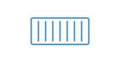

## Présentation sommaire du cours

L'étudiant pourra choisir les caractéristiques de serveurs (physiques ou virtuels) et le système d'exploitation appropriés répondant à des besoins particuliers. Il sera en mesure d'assurer la gestion des différentes ressources du ou des serveurs, et de déployer une pile LAMP (Linux, Apache, MySQL et PHP) dans des contextes de virtualisation, locale et infonuagique, pour y installer des applications Web : gestionnaire de contenu, outils de performance, sécurité à l'aide d'un pare-feu et de certificats HTTPS. À la fin du cours, l'étudiant sera en mesure de rédiger la documentation permettant l'installation d'un serveur, puis de la mettre en œuvre.

- **Programme** : 420.B0 · Techniques de l'informatique
- **Famille** : Soutien aux utilisateurs et réseau
- **Pondération** : 0-3-1
- **Préalables** : 420-1C5-JR, 420-2C5-JR

## Horaire et disponibilités de l'enseignant

**Alain Boudreault**, enseignant au département de Techniques de l'informatique, Cégep de Saint-Jérôme

- **Courriel** : [Aboudrea@cstj.qc.ca](mailto:Aboudrea@cstj.qc.ca)
- **Téléphone** : poste 6516
- **Local** : D125e

## A) Plan de cours

 *Le plan officiel de la session*

-  01 · [Plan de cours, automne 2024 (PDF)](Documentation/fichiers/420-3C3-JR_ab_pc_A24.pdf)

## B) Virtualisation et serveurs Web

 *Linux, Apache, pile AMP, WordPress*

-  02 · [Concepts de virtualisation : N1/N2](Documentation/Virtualisation-des-technologies-web.md)
-  + · [Installation d'Ubuntu Serveur](Documentation/Virtualisation-d-Ubuntu.md)
-  03 · [Retour sur les commandes de base de Linux](Documentation/Commandes-Linux.md)
-  04 · [Apache2](Documentation/Apache2-Mise-en-route.md)
-  05 · [Laboratoire S3 – Apache](Documentation/Laboratoire-S3-Apache.md) · facultatif
-  06 · [Installation et configuration d'une pile AMP](Documentation/Ajout-d-une-pile-AMP.md)
-  07 · [Mise en place et configuration de ufw (Uncomplicated FireWall)](https://doc.ubuntu-fr.org/ufw) · lien externe
-  08 · [Installation et configuration de WordPress](Documentation/Installer-WordPress.md)
-  09 · [Apache 2 – Hôtes virtuels](Documentation/Apache2-Hotes-virtuels-et-htaccess.md)
-  11 · [Installation d'un certificat signé sur un hôte virtuel (certbot)](http://ve2cuy.com/420-21e/index.php/installation-dun-certificat-signe-sur-un-hote-virtuel-apache2/) · lien externe
-  12 · Installation d'un certificat auto-signé (pour une application Web locale) · facultatif
-  13 · Stratégies de sécurité des serveurs Web (fail2ban, Lynis, Kali Linux, Kasm via Docker) · facultatif
-  14 · [Sauvegarde et restauration d'un site WordPress](Documentation/WordPress-Sauvegarde-et-restauration.md)
  - Staging

## C) Serveurs d'entreprise et services réseau

 *ESXi, Vagrant, ssh, NFS, SMB, FTP*

-  15 · [ESXi – Installation](Documentation/VMware-ESXi-et-vCenter.md)
-  16 · [Serveurs d'entreprises](Documentation/Serveurs-d-entreprises.md)
-  17 · [Vagrant – Automatisation de la création de VMs](Documentation/Vagrant-Automatisation-creation-VM.md)
-  18 · [ssh, clés (private/public) et fichier « config »](Documentation/Configuration-et-utilisation-de-ssh.md)
-  19 · [NFS – Installation et utilisation](Documentation/NFS-Installation-et-utilisation.md)
-  20 · [Mise en place du protocole SMB](Documentation/Mise-en-place-d-un-serveur-SMB.md) · facultatif
-  21 · [Installation d'un serveur FTP](Documentation/Installation-d-un-serveur-FTP.md)
  - vsftpd, pare-feu, FileZilla
-  23 · [Ansible – Introduction](Documentation/Ansible-Introduction.md) · facultatif
-  24 · [Démonstration d'une application en micro-services (introduction à Docker)](https://4204d4.ve2cuy.com/docker-introduction/) · lien externe

## D) Projets

 *Projet 1 et épreuve synthèse*

-  10 · [Projet numéro 1](Documentation/Projet-01-A2024.md) · 30 %
-  22 · [Projet numéro 2 – Épreuve synthèse 2024](Documentation/Epreuve-synthese-2024.md)
